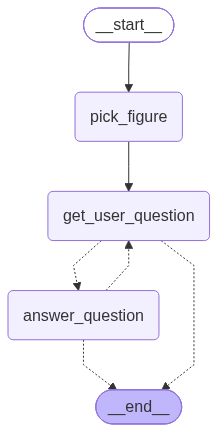

# guess-game

A "20 questions"-style guessing game about Chinese historical figures, built with [LangGraph](https://github.com/langchain-ai/langgraph) and Claude on AWS Bedrock.

The game secretly picks a famous Chinese historical figure. You ask yes/no questions (or make a guess) in Chinese, and the LLM answers in character. You have up to **10** questions to name the figure.

Playable from a terminal (CLI) or over HTTP (FastAPI).

## How it works



The game is a LangGraph `StateGraph` (`src/guess_game/core/graph.py`) with three nodes:

| Node | What it does |
| --- | --- |
| `pick_figure` | Picks a dynasty at random (weighted by `DYNASTIES`), asks the LLM for 50 candidate figures from it, and picks one at random as the secret figure. |
| `get_user_question` | Pauses the graph with `interrupt()` and waits for your input. `/giveup` ends the game. |
| `answer_question` | Asks the LLM, in character as the secret figure, whether your input is a question or a guess, and returns a structured `Answer` (`provenance`, `is_guess`, `is_correct`, `answer`). |

The game ends when you guess correctly (`won`), run out of questions (`lost`), or give up (`gave_up`).

State is kept with an in-memory `MemorySaver` checkpointer, keyed by thread ID. Games are lost when the process restarts.

## Project layout

```
src/guess_game/
├── api/app.py          # FastAPI app
├── cli/__init__.py     # Interactive terminal game
├── core/
│   ├── graph.py        # LangGraph definition + checkpointer
│   ├── llm.py          # Bedrock model + prompt setup
│   └── state.py        # State, Answer, Turn, MAX_QUESTIONS
└── nodes/              # Graph nodes
```

## Requirements

- Python 3.14+
- [uv](https://docs.astral.sh/uv/)
- AWS credentials with Bedrock access to `global.anthropic.claude-haiku-5-5` in `eu-west-1`

The model, AWS profile (`dev004`), and region are set in `src/guess_game/core/llm.py`. Change them there if yours differ.

## Setup

```bash
uv sync
```

Make sure the AWS profile is logged in, for example:

```bash
aws sso login --profile dev004
```

## Play in the terminal

```bash
uv run guess-game
```

Type a yes/no question (e.g. `是皇帝吗`, `是唐朝的吗`) or a guess (e.g. `是李白吗`). Type `/giveup` to reveal the answer. When the game ends you get a review of every turn, including the factual evidence for each answer (`依据`).

## Run the API

```bash
uv run fastapi dev      # dev server with reload
# or
uv run fastapi run
```

The app entrypoint is `guess_game.api.app:app` (set under `[tool.fastapi]` in `pyproject.toml`). Interactive docs are at `http://localhost:8000/docs`.

### Endpoints

| Method | Path | Description |
| --- | --- | --- |
| `GET` | `/health` | Health check |
| `POST` | `/create` | Start a new game. Returns `{"game_id": ...}` |
| `POST` | `/game/{game_id}/turns` | Ask a question or make a guess. Body: `{"question": "..."}` (1–100 chars) |
| `GET` | `/game/{game_id}/summary` | Game status and history. Factual evidence and the secret figure are only shown once the game has ended |
| `POST` | `/game/{game_id}/give_up` | Give up and reveal the secret figure |

`answer` in responses is a boolean: for a question it means yes/no, and for a guess it means correct/incorrect. Calling `turns` or `give_up` on a finished game returns `409`, and an unknown `game_id` returns `404`.

### Example

```bash
GAME_ID=$(curl -s -X POST localhost:8000/create | jq -r .game_id)

curl -s -X POST localhost:8000/game/$GAME_ID/turns \
  -H 'Content-Type: application/json' \
  -d '{"question": "是皇帝吗"}'

curl -s localhost:8000/game/$GAME_ID/summary
```

## Configuration

| Setting | Location |
| --- | --- |
| Max questions per game | `MAX_QUESTIONS` in `core/state.py` |
| Dynasty weights | `DYNASTIES` in `nodes/pick_figure.py` |
| Candidates per pick | `CANDIDATE_COUNT` in `nodes/pick_figure.py` |
| Model / AWS profile / region | `core/llm.py` |
