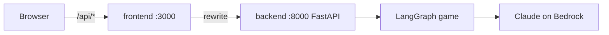

# guess-game

A "20 questions"-style guessing game about Chinese historical figures, built with [LangGraph](https://github.com/langchain-ai/langgraph) and Claude on AWS Bedrock.

The game secretly picks a famous Chinese historical figure. You ask yes/no questions (or make a guess) in Chinese and have up to **10** tries to name the figure. Play it in the browser or in a terminal.

## Repository layout

```
.
├── Makefile    # one-command install / dev for both apps
├── backend/    # LangGraph game + FastAPI server (Python, uv)
└── frontend/   # Next.js web client (TypeScript, bun)
```



The frontend proxies `/api/*` to the backend, so no CORS setup is needed.

## Requirements

- Python 3.14+ and [uv](https://docs.astral.sh/uv/)
- [bun](https://bun.sh/)
- AWS credentials with Bedrock access (see [backend/README.md](backend/README.md#requirements))

## Quick start

```bash
aws sso login --profile dev004
make install   # uv sync + bun install
make dev       # backend on :8000 and frontend on :3000, Ctrl+C stops both
```

Then open http://localhost:3000.

| Command | What it does |
| --- | --- |
| `make install` | Install backend and frontend dependencies |
| `make dev` | Run both apps with hot reload |
| `make backend` | Run only the FastAPI server |
| `make frontend` | Run only the Next.js dev server |

## More

- [backend/README.md](backend/README.md): game graph, API endpoints, CLI, configuration
- [frontend/README.md](frontend/README.md): web client structure, scripts, configuration
